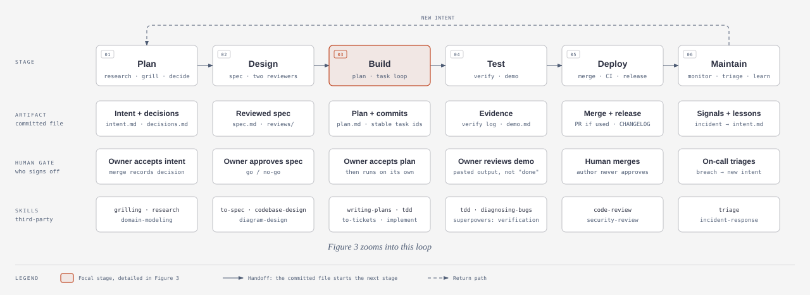
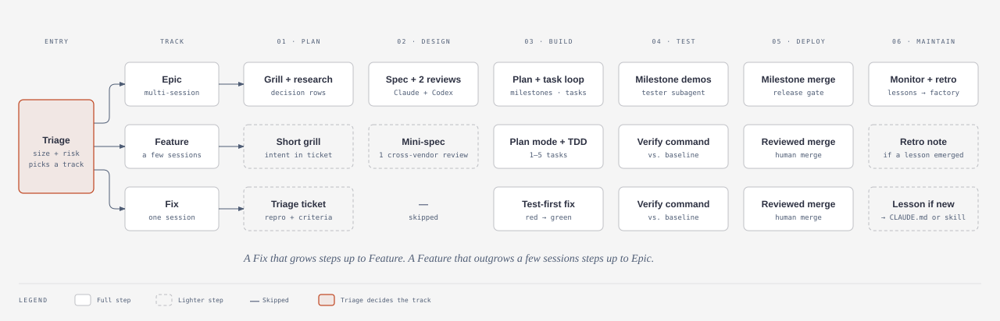
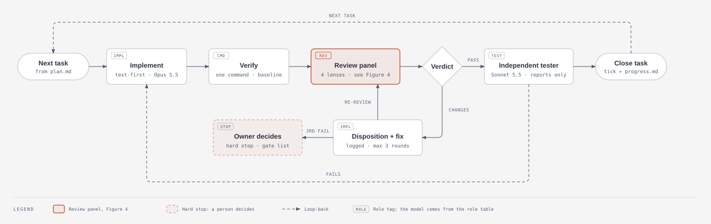
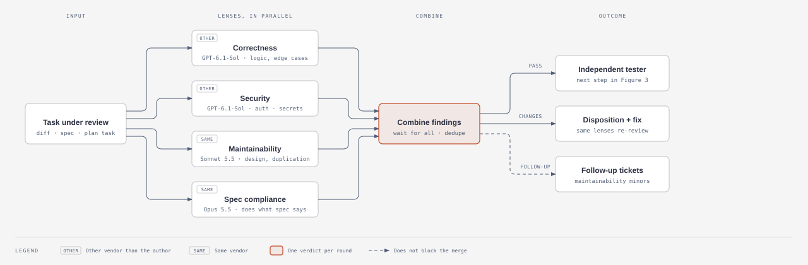
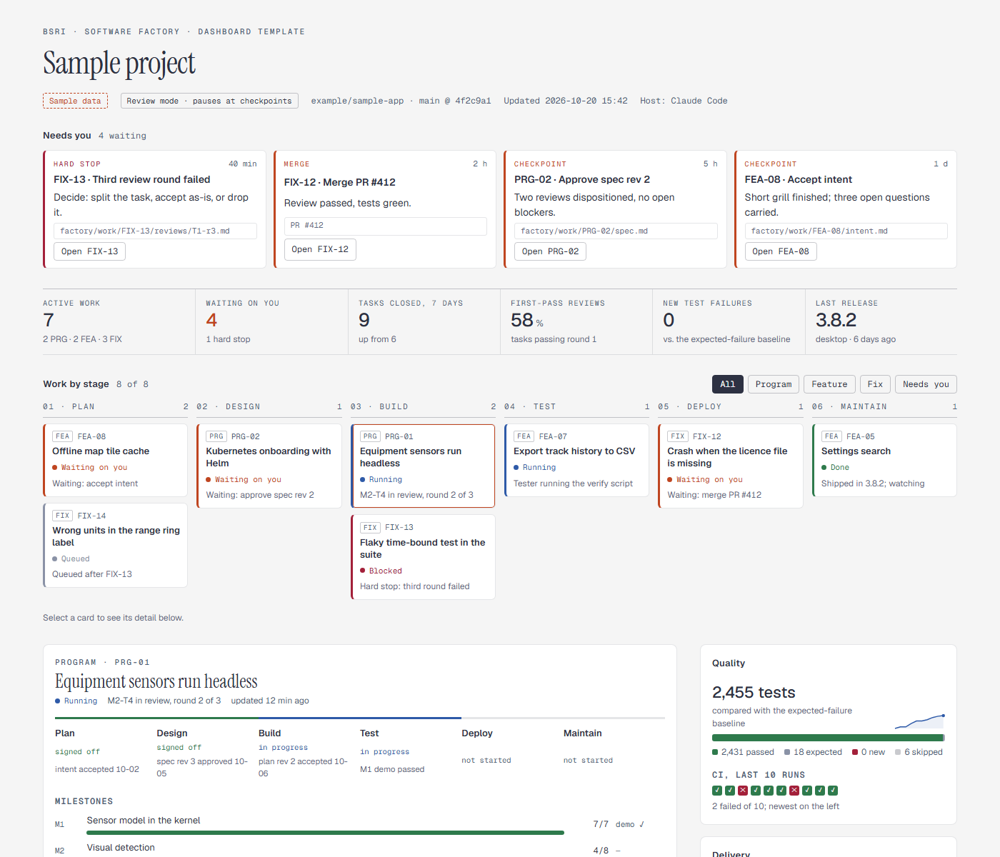

# Software Factory

A reusable way for BSI teams to take work from an idea to running software with AI agents. It runs in **Claude Code** and in **Codex** (CLI and the ChatGPT desktop app), lets one model drive another, and scales from a one-session bug fix to a multi-week program.

> **Status: version 1 core built and merged; not yet piloted.** Built: the `factory` command, the skills for project setup, triage, the work-item orchestrator, the task loop, the review panel and the merge gate, the reviewer and tester subagents and prompts, the role table and the plugin manifests. Its tests pass on Windows and Linux, and a rehearsal on a sample app ran a Fix from setup to a passing merge gate with real Codex reviews ([results](docs/acceptance/2026-10-20-v1-rehearsal-results.md)). Next come the owner-attended runs in each host ([checklist](docs/acceptance/v1-checklist.md)) and a first real project. The sections after Install describe the full [design](docs/specs/2026-10-20-software-factory-design.md) (see also the [decision log](docs/decisions.md)); the [repository layout](#repository-layout) says which parts exist today. The figures below come from the [factory map](docs/map/factory-map.html), which you can open locally in a browser.

## Install

The short version; the [install guide](docs/guide/install.md) has the prerequisites, every command and the third-party skills to add.

1. Clone this repository and install the `factory` command from it with `pipx install -e tools` (the install guide has other ways; don't put a virtual environment's folder on your PATH), then check `factory --version`.
2. Claude Code: `claude plugin marketplace add Battlespace-Research/software-factory`, then `claude plugin install software-factory@bsri-factory`.
3. Codex: `codex plugin marketplace add Battlespace-Research/software-factory`, then `codex plugin add software-factory@bsri-factory`.
4. Install the third-party skills, then check both hosts with `factory skills check --host claude` and `factory skills check --host codex`.

## Quick start

You drive the factory by talking to Claude Code or Codex in your project. Open a session at the root of the project's repository, with no uncommitted changes, then:

1. **Set up the project, once.** Say *"Set up this repository for the software factory."* Or pick the skill: in Claude Code, type `/` and choose `software-factory:factory-setup`; in Codex, type `$` and choose `factory-setup`. It asks you one question at a time (verify commands, approvers, branching), shows every file it made, and commits on a `factory/setup` branch once you approve. You merge that branch.
2. **Bring it work.** Say *"Triage this for the factory: the range-ring label shows m for values in km."* It proposes a track (Fix, Feature or Program) with its reason, opens a work item, and writes the ticket or intent for you to approve.
3. **Approve in chat.** At each checkpoint it asks one question. Reply *"Approved"* and your exact words are recorded with the commit you approved; or say what to change, and it changes it and asks again.
4. **Let it run.** It writes a failing test first, fixes, runs your verify command, has reviewers from the other vendor check the change (Claude Code calls Codex; Codex calls Claude), and runs the merge gate. It stops for you at every hard stop, such as anything that touches the main branch, credentials or new dependencies.
5. **You merge.** When the gate passes it gives you what changed, the review results, the verify output and the merge commands. A person always merges.

To see where any piece of work stands, ask the agent, or run `factory work status <ID>`. [Using the factory](docs/guide/using-the-factory.md) walks through all of this in detail, including Features, review and auto modes, and where every file lives. The [command reference](docs/guide/reference.md) lists every skill and every `factory` command.

## Why it exists

The NGC2 prototype for MACE ran on a disciplined, multi-model runbook:
- grilling interviews that produce numbered decisions;
- a reviewed spec and plan;
- a loop for each task, in which Claude implements, a GPT model reviews through Codex, and a Claude tester verifies.

It worked, but it lived in one project's runbook, one person's scripts and one agent's memory. The factory packages that process so any project can use it, and corrects the problems NGC2 ran into.

It also plans for change. Models get replaced often, so every model is named in exactly one place, and swapping one is a one-line edit you can check.

## Principles

- **Six stages, aligned with the [Claude Academy AI-Native SDLC Playbook](https://academy.claude.com/courses/ai-native-sdlc-playbook):** Plan, Design, Build, Test, Deploy, Maintain.
- **Each stage ends by committing a file,** and that commit starts the next stage.
- **A person signs off at every stage.** An agent never approves or merges its own work.
- **Work state is plain files in the project's own repo.** GitHub issues are an optional mirror.
- **Models are bound to roles in one table,** never hard-coded in skills, prompts or scripts.
- **The right amount of process for the size of the work.** A fix is not a program.
- **You can always see where things stand,** through a map of the factory and a dashboard of the work.

## The lifecycle

<picture>
  <source media="(prefers-color-scheme: dark)" srcset="docs/map/figures/lifecycle-dark.svg">
  
</picture>

| Stage | What happens | Commits | Who signs off |
|---|---|---|---|
| **Plan** | Research, then a grilling interview, one question at a time | `intent.md`, `decisions.md` | The owner accepts the intent |
| **Design** | Spec, reviewed by one Claude and one GPT reviewer | `spec.md`, `reviews/` | The owner approves the spec |
| **Build** | Plan, then the task loop for every task | `plan.md`, commits | The owner accepts the plan |
| **Test** | Verify command, independent tester, milestone demos | Verify output, `demo/` | The owner reviews the demo |
| **Deploy** | Merge gate, then release: desktop installer and/or Helm | Changelog, release record | A person merges and releases |
| **Maintain** | Signals checked against normal ranges, plus a retro at close | New `intent.md`, lessons | Whoever is on call triages |

## Three tracks

<picture>
  <source media="(prefers-color-scheme: dark)" srcset="docs/map/figures/tracks-dark.svg">
  
</picture>

Triage puts each piece of work in the smallest track that fits:
- **Fix:** one session, one task. Write a failing test first, then fix it, review it and merge it.
- **Feature:** up to about five tasks. It gets a short grill, a mini-spec and plan mode.
- **Program:** milestones, many sessions and the full process.

When work outgrows its track, it steps up and keeps its history.

## The task loop

<picture>
  <source media="(prefers-color-scheme: dark)" srcset="docs/map/figures/task-loop-dark.svg">
  
</picture>

Every planned task follows the same loop:
1. Implement test-first.
2. Run the project's verify command.
3. Have the review panel review it.
4. Answer every finding: accepted, modified or declined, with a reason.
5. Get re-reviewed. A third failed round stops for the owner.
6. An independent tester, who never edits product code, checks the result.
7. Close the task.

"Done" always means pasted verify output, compared with a baseline of known failures rather than with "green".

## The review panel

<picture>
  <source media="(prefers-color-scheme: dark)" srcset="docs/map/figures/review-panel-dark.svg">
  
</picture>

Reviewers work in parallel, each with one lens and a checklist from the project's `REVIEW.md`:
- **Correctness**
- **Security**
- **Maintainability**
- **Spec compliance**

At least one lens comes from the other vendor than the author. By default that's correctness and security.

Each reviewer:
- writes its verdict on the first line of its review file;
- reads the code before reading the implementer's summary;
- re-checks its own earlier findings in the next round.

A blocker or major finding from any lens sends the task back. Maintainability findings alone never block; they become follow-up tickets.

## Roles and models

Every model is bound to a role in one file, `config/roles.yaml`, and a project can override any binding. "Other vendor" is resolved relative to whoever wrote the work, so the rule still holds when Codex is the host and GPT writes the code. Today's defaults:

| Role | Default | Runs as |
|---|---|---|
| Interviewer, spec and plan author | Fable 5.1 · xhigh | main session |
| Researcher | Sonnet 5.5 · high | read-only subagent |
| Document reviewers A / B | Opus 5.5 · xhigh / GPT-6-Astra · xhigh | subagent / `codex exec`, read-only |
| Implementer | Opus 5.5 · xhigh | main session |
| Lens reviewers: correctness, security | GPT-6.1-Sol · xhigh (other vendor) | `codex exec`, read-only |
| Lens reviewers: maintainability / spec | Sonnet 5.5 · high / Opus 5.5 · high | subagents, no edits |
| Tester | Sonnet 5.5 · high | subagent, no product edits |
| Release checker, triage and on-call | Sonnet 5.5 · high | headless, read-only |

The factory's own **evals** are real past tasks rerun whenever a model, skill or prompt changes. They are how a swap gets checked before it lands.

## How work runs

- **Review mode (default):** the factory pauses for you at the intent, the spec, the plan, each milestone demo and the merge. In between, it runs on its own.
- **Auto mode (opt-in):** checkpoints become notes and the work continues. Only hard stops halt it.
- **Approvals happen in chat.** The factory records your exact words, the time and the commit you approved.
- **Hard stops,** in either mode:
  - anything touching main;
  - deleting data;
  - credentials or licences;
  - installers or admin prompts;
  - purchases;
  - changes to auth, money handling or schemas;
  - new dependencies;
  - production data;
  - a third failed review round.
- **Sessions hand off cleanly.** `progress.md` is the resume point, every step commits, and a session hands over near its token budget.

A project set up for the factory gets:

```
<project>/
  factory.yaml        verify command, tracks, mode, hard stops, deploy paths, signals, role overrides
  REVIEW.md           the review checklist
  CLAUDE.md/AGENTS.md a short factory section
  factory/work/<ID>/  intent, decisions, spec, plan, progress, reviews, approvals, demo, retro
```

## Deploy and Maintain

There are two release paths, and a project can use either or both:
- **Desktop installer:**
  1. Build and sign it in CI.
  2. Smoke-test it.
  3. Publish it to beta.
  4. You promote it to stable.
  5. Rollback re-publishes the previous installer.
- **Kubernetes with Helm:**
  1. Lint and policy-check the chart.
  2. Deploy to dev automatically.
  3. Deploy to staging and prod only with your approval.
  4. Agents never hold standing production credentials.
  5. Rollback is rehearsed every release.

In **Maintain**, each signal has a normal range, and anything outside it becomes a draft intent for triage. Every piece of work ends with a retro, and repeat mistakes become proposed additions to the project's `CLAUDE.md`, `REVIEW.md` or skills, where the whole team benefits.

## The dashboard

<picture>
  <source media="(prefers-color-scheme: dark)" srcset="docs/dashboard/screens/dashboard-dark.png">
  
</picture>

The dashboard is rebuilt at every checkpoint and task close from the project's factory files, git, CI and release records. The template above uses made-up sample data. Its panels:
- what needs you;
- key numbers;
- work by stage;
- the selected item's gates, milestones, current task and per-lens review results;
- quality against the baseline;
- delivery for the desktop installer and Helm, with DORA metrics;
- factory health, using the playbook's indicators;
- which model fills each role;
- recent activity.

The dashboard is never the source of truth: every number traces back to a file or a record.

## Third-party skills

The factory calls installed skills rather than copying them. It checks they are present before a run and names a fallback for each. The [install guide](docs/guide/install.md) says which are required and how to install them.

| Stage | Skills | Source |
|---|---|---|
| Plan | `grilling`, `research`, `domain-modeling`, `last30days` | Matt Pocock skills, last30days |
| Design | `to-spec`, `codebase-design`, `diagram-design` | Matt Pocock skills, Cathryn Lavery |
| Build | `writing-plans`, `subagent-driven-development`, `to-tickets`, `wayfinder`, `implement`, `tdd` | superpowers, Matt Pocock skills |
| Test | `tdd`, `diagnosing-bugs`, `verification-before-completion` | Matt Pocock skills, superpowers |
| Deploy | `code-review`, `security-review`, `deploy-checklist` | Matt Pocock skills, Claude Code, Anthropic engineering plugin |
| Maintain | `triage`, `incident-response` | Matt Pocock skills, Anthropic engineering plugin |
| Any | `handoff` | Matt Pocock skills |

## Repository layout

What exists today. The factory is one plugin, `software-factory`, with a Claude Code manifest and a Codex manifest that share one `skills/` folder:

```
.claude-plugin/    the Claude Code plugin manifest and its marketplace (bsri-factory)
.codex-plugin/     the Codex plugin manifest
.agents/plugins/   the Codex marketplace (bsri-factory)
skills/            the factory skills: setup, triage, run, task loop, review panel, merge gate
agents/            Claude Code subagents: lens reviewer, document reviewer, tester, researcher
prompts/           the four review lenses, the document review and the tester brief
schemas/           the JSON schema of a review
config/            roles.yaml (the role table, the one file that names models) and skills.yaml (third-party skills)
templates/         project/ (what setup creates in a project) and work/ (a new work item's files, per track)
tools/             the factory command (Python package swfactory) and its tests
examples/          sample-app, the small project with a planted bug that the acceptance run works on
docs/
  guide/           the install guide, the walkthrough and the command reference
  acceptance/      the v1 acceptance checklist and the results of each run
  specs/           the design
  plans/           the implementation plan
  decisions.md     the decision log (F-rows, append-only)
  map/             the factory map (HTML) and the exported figures
  dashboard/       the dashboard template and screenshots
```

Not built yet, per the design: the dashboard and map generators, the Deploy, Maintain, dashboard and evals skills, and `evals/`.

## Roadmap

1. Owner approves the design. **Done** (F15).
2. Implementation plan. **Done:** [plan 1 of 4](docs/plans/2026-10-20-factory-core-v1.md), the core, is written.
3. Version 1: project setup, triage, the Fix and Feature tracks, the review panel, the role table and host adapters, tested on a small sample repo. **Built and merged:** reviewed task by task and as a whole, tested on Windows and Linux, and rehearsed from the command line on the sample repo ([results](docs/acceptance/2026-10-20-v1-rehearsal-results.md)). The owner-attended run in both hosts ([checklist](docs/acceptance/v1-checklist.md)) is next.
4. Pilot on a real project, likely a new MACE plugin.
5. The Program track and the dashboard generator.
6. Deploy paths (desktop installer and Helm) and Maintain.
7. Factory evals in CI, then hooks that enforce the rules.

## Sources and credits

- The NGC2 prototype runbook and its lessons (MACE, branch `MACE-NGC2-Prototype`).
- Claude Academy, [AI-Native SDLC Playbook](https://academy.claude.com/courses/ai-native-sdlc-playbook).
- [zazencodes software factory](https://github.com/zazencodes/zazencodes-season-3/tree/main/src/software-factory-claude-code): ideas only, since it has no license.
- [super-board](https://github.com/EricTechPro/super-board) (MIT).
- Figures drawn with the [diagram-design](https://github.com/cathrynlavery/diagram-design) skill.

Internal to BSRI (Battlespace-Research) and proprietary; the plugin manifests say `Proprietary`. No open-source license has been chosen.
